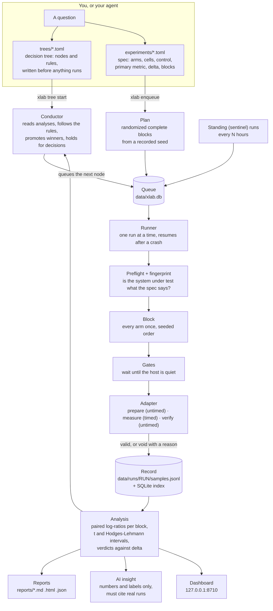

# xlab

xlab is a small, dependency-free laboratory for running experiments properly and
unattended. You write down a question as a **spec** (what is compared, under which
conditions, against which control, and how large a difference matters) or as a
**decision tree** of specs (what to run next depending on what the last one found).
xlab turns each spec into a **randomized block plan**, queues it, runs it on a
**runner** that survives crashes and reboots, writes every sample as a
self-describing record, analyses the results with **paired statistics** that give
a verdict with an interval rather than a bare number, follows the tree's
pre-registered rules, writes a **local report** every few hours (optionally with
an **AI analysis** that may cite only the evidence it was given), and shows all of
it live on a **dashboard**.

Nothing in the core knows what is being measured. An **adapter** says how one
sample is taken. Four ship with xlab:

| Adapter | Measures |
|---|---|
| `command` | Any shell command, timed by the kernel (`wait4`), with optional setup, verification and self-reported metrics |
| `compression` | Command-line compressors (zstd, xz, gzip, pigz, bzip2, brotli, lz4) on pinned corpora: time, CPU, peak memory, ratio, MB/s, with a verified round trip |
| `manual` | Experiments that are not run on the computer: people or instruments take each sample and the result is entered later |
| `simulated` | Synthetic samples with known effects, for trying the lab and checking the statistics |

Python 3.11 or newer and nothing else: no pip packages, no build step, no
services. The same code runs on a laptop, a Raspberry Pi or a server.

---

## Get started with your agent

xlab is meant to be driven by a coding agent (Claude Code, Codex, Cursor or
any other) as much as by hand. The agent reads this README and the adapter
docstrings, writes the specs and trees, and runs the commands; you supply the
question and the decisions. The project skill planned in
[backlog.md](backlog.md) will make the method automatic; until then, the prompts
below carry it.

The scenario: a machine somewhere is collecting data. Say a small server
receives sensor readings all day into `/srv/telemetry/`, one newline-delimited
JSON file per hour, about 2 GB a day. A nightly job compresses yesterday's
directory with `gzip -6` into `/srv/archive/`, and a second job aggregates the
day into a SQLite database. You want to know whether those jobs could be
faster, without disturbing the collection that keeps running beside them.

**1. Tell your agent to clone the repo and set up a lab on that machine.**

> Clone the xlab repository at `https://github.com/s4njee/xlab` onto this machine,
> install it with `pip install -e .` using a Python of 3.11 or newer, run
> `xlab selftest` and tell me whether it passed. Then make a lab at
> `~/labs/telemetry` with `xlab init --example compression`, and set
> `max_load_per_core = 0.5` in its `lab.toml`, because the collector writes to
> this host all day and I only want samples taken while the host is quiet.

**2. Tell your agent what is being collected, and where.**

> Readings land in `/srv/telemetry/YYYY-MM-DD/HH.jsonl`, about 2 GB a day. The
> nightly archive job runs `gzip -6` over yesterday's directory into
> `/srv/archive/`. Yesterday's directory is `/srv/telemetry/2026-10-17`. Never
> read the live directory during a timed sample: pack a copy of it as a corpus
> pinned by digest, so every arm sees the same bytes.

The agent should answer with a `[corpora.telemetry-day]` table in the spec,
pointing `path` at that directory, which the compression adapter packs once
into a tar with sorted members and records the SHA-256 of in every sample.

**3. Tell your agent to set up a decision tree with the questions to be
investigated.**

> Set up a decision tree in the lab with these questions, in this order, and do
> not run anything yet:
>
> 1. Which codec settings compress a day of telemetry faster than `gzip -6`
>    without losing more than 3% of its compression ratio? Screen zstd 1 to 9,
>    lz4, brotli 4 and xz 1 against `gzip -6` as the control, six blocks, with a
>    5% smallest effect that matters.
> 2. If any setting qualifies, confirm exactly those settings with twelve fresh
>    blocks as a confirmatory experiment.
> 3. If a setting is only faster by giving up ratio, stop and hold for my
>    decision.
> 4. If the confirmed winner is zstd, screen whether 2, 4 and 8 threads make
>    its higher levels practical.
>
> Validate the tree and every spec with `xlab check`, show me the plan each spec
> would get with `xlab plan`, and show me the tree before starting it.

What comes back should look like the `T1-log-archives` example that
`xlab init` put in the lab, with the telemetry corpus in place of the generated
ones: a `screen` node on a spec like `C2-replace-gzip`, a `promote` node for
the confirmation, a `hold` branch, and a `threads` node on a spec like
`C3-zstd-threads`.

**4. Tell your agent to start the tree and keep the lab running.**

> Start the tree, add the sentinel spec as a standing run every six hours so we
> see the noise floor through the day, print the launchd or systemd unit from
> `xlab service` and install it so `xlab up` survives a reboot. Tell me the
> dashboard address. When the tree takes its first decision, tell me which
> branch it took and why.

**5. Tell your agent to enqueue a one-off experiment alongside the tree.**

> The aggregation job is `/srv/jobs/aggregate.py --day DAY --out DB`. Enqueue
> an experiment with the `command` adapter: does `--parallel 4` make it faster
> than the default on yesterday's directory? Use the default as the control,
> eight blocks, and verify every sample by checking the row count of the
> output database in the `after` command. Put it at the front of the queue.

**6. Tell your agent to read the result.**

> Analyse the screening experiment. For each arm tell me the ratio to
> `gzip -6`, its interval and the verdict, and whether the decision tree has
> moved. Where a verdict is inconclusive, tell me how many blocks the analysis
> says would resolve it, and what that would cost in hours on this host.

The rules the agent is expected to keep, whatever the question: a control arm
and a smallest effect that matters are named before anything runs; a failed
sample is void, never a number; the live data directory is never in a timed
path; and a verdict comes with its interval.

---

## How it works, in one picture



---

## Contents

0. [Get started with your agent](#get-started-with-your-agent)
1. [Why xlab exists](#why-xlab-exists)
2. [Quick start](#quick-start)
3. [How it works](#how-it-works)
4. [Setting up a custom experiment](#setting-up-a-custom-experiment)
5. [Experiments off the computer](#experiments-off-the-computer)
6. [Calibration: trusting the lab before trusting a result](#calibration-trusting-the-lab-before-trusting-a-result)
7. [Configuration](#configuration)
8. [Command reference](#command-reference)
9. [Development](#development)
10. [Lineage and roadmap](#lineage-and-roadmap)

---

## Why xlab exists

### The problem

Most benchmarks are three runs and a look. They are measured once, in whatever
order the author typed them, on a machine doing other things, and the number that
comes out is reported to three significant figures with no interval. When the
result is later contradicted nobody can say which measurement was wrong, because
neither recorded the state of the machine, the exact binary, or whether a failed
run was quietly counted as a timing.

xlab came out of a lab that was built to stop doing that for a file-transfer
tool, after its own earlier results had to be retracted for exactly those reasons
(see [Lineage](#lineage-and-roadmap)). The rules that fixed it are not specific to
file transfer, so they were taken out and put behind an adapter interface.

### The principles

1. **Paired, blocked, randomized.** The arms of an experiment are measured inside
   short blocks, back to back, in an order drawn from a recorded seed. Slow drift
   (a warming CPU, a filling disk, a busy hour, a provider's load) cancels out of
   each paired comparison instead of becoming a result.
2. **Ratios, not seconds.** The estimand is the ratio of an arm to the control in
   the same block. Absolute values are recorded and reported but never pooled
   across machines or days as if they were comparable.
3. **Declared before measured.** The spec names the hypothesis, the control, the
   primary metric and the smallest effect that matters before the first sample.
   The analysis reads only what the spec declares. Trees are written before the
   first node runs.
4. **Void, never drop.** A sample that could not be taken (the tool failed, the
   output did not verify, the host was busy, the system under test changed) is
   recorded with its reason and never a value. Its block is retried in a fresh
   order. No sample is ever dropped for being slow.
5. **Verification owes nothing to the arms.** A compressor's output is checked
   against the corpus digest, not against another compressor. A grader must be
   independent of the thing it grades.
6. **The system under test is proven before and fingerprinted during a run.**
   Preflight refuses a run whose tools or inputs are not what the spec says; a
   fingerprint that changes mid-run fails the run rather than mixing two systems
   in one analysis.
7. **The lab measures itself.** Sentinel runs repeat a fixed measurement through
   the day for the noise floor and drift; a selftest checks the statistics
   against known answers; nothing is believed before an A/A comes out equivalent.
8. **Nothing a model writes is a measurement.** The AI analysis sees numbers and
   labels only, must cite runs that exist, and is labelled as model-written.

### The ambition: a testing framework for AI agents

Today xlab measures compressors, shell commands, simulations and manual trials.
The plan in [backlog.md](backlog.md) takes the same machinery to a new system
under test: an **AI agent configuration**. An arm becomes a model, a prompt, a set
of skills, a tool set and a harness version; a corpus becomes a **task suite**
pinned by digest; a cell is a suite under declared conditions such as prompt-cache
state and tool availability; the grader is the verification step; API errors and
rate limits are voids, never scores; and the fingerprint includes the model
version string the provider returns, so a model that changes under the same name
is caught the way a changed binary is today.

The brief for that work is one sentence, and it will be the first sentence of
the project's documentation site:

> As a researcher I want to run experiments without blowing the budget on AI
> tokens, so every run is planned, priced and paired before the first token is
> spent, and stops by itself when the day's budget is gone.

The backlog also plans the surface that makes this usable from a coding agent:
a CLI with `--json` everywhere and the cost shown before anything runs, a
project skill that teaches the method (ask for a hypothesis, pick a control, set
delta, show the spend, read a verdict), and root `CLAUDE.md` and `AGENTS.md`
files, so that someone can clone this repository and tell their LLM "I want to
start an experiment involving …" and have it done properly. None of that exists
yet; everything described in the rest of this README does.

---

## Quick start

Use a Python of 3.11 or newer. On macOS the system `python3` is older and lacks
`tomllib`; Homebrew's works.

```bash
python3 -m pip install -e .          # or: export PYTHONPATH=/path/to/xlab
xlab init ~/labs/demo                # a lab directory with every example in it
cd ~/labs/demo
xlab tree start trees/T0-demo.toml   # a one-minute simulated tree
xlab up                              # runner + trees + reports + dashboard
```

Open http://127.0.0.1:8710/. `xlab up` keeps going until it is stopped; Ctrl-C
finishes the current sample, and the run resumes at its first unfinished block
next time.

The compression examples:

```bash
xlab enqueue experiments/C0-smoke.toml           # 12 samples: is the harness sane?
xlab enqueue experiments/C1-frontier.toml        # 17 codec settings x 4 kinds of data
xlab tree start trees/T1-log-archives.toml       # should log archives leave gzip -6?
xlab standing add experiments/S0-sentinel.toml --every-hours 6   # the noise floor, around the clock
xlab analyze C1-frontier                         # ratios, intervals, Pareto fronts
```

Before trusting anything, run the statistics against known answers:

```bash
xlab selftest
```

---

## How it works

### The lab directory

A lab is a directory. Everything xlab knows is in it, as plain files plus one
SQLite index that can be rebuilt from them.

```
LAB/
  lab.toml              settings (every key optional; see Configuration)
  experiments/*.toml    specs
  trees/*.toml          decision trees
  adapters/*.py         optional lab-specific adapters, loaded automatically
  drafts/               trees drafted by a model with `xlab tree draft`, never queued by themselves
  data/
    xlab.db             the index: runs, samples, queue, trees, events, documents (SQLite, WAL)
    runs/RUN/           the record of one run:
      spec.toml           the spec text exactly as it was when planned
      plan.json           seed, every block, every arm order, every retry order
      preflight.json      what was checked before the first sample
      env.json            host and adapter fingerprints for every session of the run
      samples.jsonl       one fsynced JSON line per sample
      run.log
    scratch/RUN/        per-run working space, removed when the run ends
    corpora/            generated or packed inputs, with manifests, pinned by digest
  reports/              periodic reports (.md, .html, .json) and AI insights
```

`samples.jsonl` is the scientific record; the database is an index over it so the
runner, trees, reports and dashboard can query without re-reading every file.

### Components

| Module | Job |
|---|---|
| `spec.py` | Loads and validates a spec: arms (given or generated from `[[grid]]`), factors crossed into cells, control, primary metric, delta, kind, Pareto pairs. Hashes the spec text. |
| `plan.py` | Turns a spec and a seed into a randomized complete block plan. Every order is a pure function of (seed, replicate, cell, attempt). |
| `runs.py` | Enqueues a plan (writes the run directory), cancels runs, opens and records manual tasks, imports CSVs. |
| `runner.py` | Works the queue one run at a time: preflight, fingerprints, gates, the adapter's prepare / measure / verify, the record. Resumes, retries, halts. |
| `measure.py` | Runs a command under `fork`/`exec` and reaps it with `wait4` for wall, CPU and peak RSS; reads host state (load, temperature, free disk). |
| `adapters/` | The `Adapter` interface and the four built-ins. The only benchmark-specific code. |
| `corpora.py` | Deterministic inputs: seeded generated kinds (`text-32m`, `logs-16m`, `random-1g`, …) and packed real directories, each pinned by SHA-256. |
| `store.py` | The SQLite index. Every write bumps a version counter the dashboard streams. |
| `stats.py` | Paired t and Hodges-Lehmann intervals, exact sign-flip test, Holm adjustment, power, Pareto fronts. Plain lists of floats in, plain numbers out. |
| `analyze.py` | An experiment's effects (ratio to control per cell, arm and metric), absolutes, Pareto fronts, noise, verdicts. |
| `trees.py` | Decision trees: rule evaluation, promotion to confirmatory runs, holds; the `Conductor` that advances them. |
| `standing.py` | Standing (sentinel) runs: the same short spec at an interval, for the noise floor by hour and drift detection. |
| `report.py` | Periodic Markdown, HTML and JSON reports. The HTML embeds the dashboard's charts and opens offline as one file. |
| `ai.py`, `insight.py` | One structured-output call to Anthropic, OpenAI or OpenRouter over plain HTTPS; the periodic evidence-only synthesis. |
| `generate.py` | `xlab tree draft`: a model turns a question into a tree and specs, validated like hand-written ones. |
| `daemon.py` | `xlab up`: runner, conductor, schedules and dashboard in one process; lock files; the launchd or systemd unit. |
| `dashboard/` | A loopback HTTP server with a JSON API and server-sent events; static HTML, CSS and SVG with no build step. |
| `selftest.py` | Runs synthetic experiments with known ratios through the real runner and analysis and checks coverage, false verdicts and power. |
| `cli.py` | The `xlab` command. |

### Data flow

The diagram under [How it works, in one picture](#how-it-works-in-one-picture)
is the map. In module terms: `spec.load` and `plan.make` turn a spec and a seed
into `plan.json` and a queued run; `trees.Conductor.tick` and `standing.queue_due`
add runs of their own; `Runner.execute` takes one run at a time through
preflight, the adapter's hooks and the record; `analyze.analyse` reads complete
blocks from the index; `report.tick`, `insight.tick` and the dashboard server
read the analyses.

### The life of a run

1. **Enqueue.** `xlab enqueue experiments/X.toml` validates the spec against its
   adapter, draws a seed (or takes `--seed`), makes the plan, writes the run
   directory with the spec text and `plan.json`, and adds the run to the queue.
   A spec can be queued several times with `--count N` for independent
   replicates with fresh seeds.
2. **Preflight.** When the runner picks the run up it asks the adapter for cheap
   checks that the system under test is what the spec says, before anything is
   built or measured. The compression adapter round-trips a buffer through every
   arm's exact command line and checks corpus sources, pins and disk space; the
   command adapter fills every template. The host and adapter fingerprint go into
   `env.json`. Any problem fails the run before its first sample, with the
   problems named. `xlab preflight SPEC` runs the same checks by hand.
3. **Warm-up.** `warmup = N` in a spec takes N untimed samples per cell and arm
   first; they are recorded as `warmup`, never analysed.
4. **Blocks.** The plan's sequence interleaves replicates of every cell. For
   each block the runner checks the fingerprint again (a change fails the run),
   then takes every arm once in that block's seeded order.
5. **One sample.** The runner waits for the gates (load per core, temperature,
   free disk; a busy host delays sampling rather than producing bad samples,
   and after `max_wait_h` the run fails), lets the adapter prepare (untimed),
   calls `measure` (timed; a wall-clock and monotonic-clock disagreement means
   the host slept and voids the sample), lets the adapter verify (untimed),
   checks that every metric is a number and the primary is present and
   positive, and appends one record to `samples.jsonl` with `fsync` before the
   next sample starts.
6. **Void and retry.** A `Void` raised anywhere in a sample records it with the
   reason and ends the block attempt; the block is tried again in a fresh seeded
   order up to `retries` more times (default 2). A block that never completes is
   abandoned and contributes nothing. A run whose first blocks are all void
   fails rather than burning through the plan.
7. **Interruption.** Ctrl-C, SIGTERM, a crash or a reboot ends the current sample
   cleanly. On the next start the run resumes at its first unfinished block; an
   interrupted block attempt is never reused. `env.json` gains one entry per
   session, and a fingerprint that differs between sessions raises a warning.
8. **Completion.** The run ends `complete`, `failed` or `cancelled`. Three
   failed runs in a row halt the runner for an hour (`halt_after_failures`,
   `halt_minutes`), so a broken host does not consume the queue.

Manual runs never occupy the runner: it turns every planned sample into a task
with instructions and moves on; results arrive through `xlab record`,
`xlab import` or the dashboard.

### The record

One JSON line per sample, the same schema for every adapter:

- **identity**: run, experiment, unit (`b003.c1.t0.zstd-3`: block, cell, attempt,
  arm), block, cell key and factors, arm and its parameters, attempt, position in
  the block, seed, spec hash, fingerprint hash;
- **result**: `state` (`valid`, `void`, `warmup`), `metrics`, `void_reason`;
- **context**: `gates` before and after (load, temperature, free bytes, the
  settle wait), `elapsed_s` of the timed interval, start and end UTC;
- **details**: anything the adapter returned under a `_` prefix (the exact
  argv, input digest), kept for audit and never analysed.

### Statistics

The unit of observation is a **complete block**: one attempt of one (run,
replicate, cell) in which every arm gave a valid sample. Within it each arm's
value is divided by the control's, and the log of that ratio is one observation.
Across blocks:

| Quantity | How |
|---|---|
| estimate | exp(mean log-ratio), with the paired t interval |
| robust check | Hodges-Lehmann estimate with its distribution-free (Wilcoxon) interval |
| p | exact sign-flip permutation test up to 16 blocks, sampled above |
| verdict | from the interval and `delta`, only when both intervals agree and there are at least `min_blocks` blocks (default 6); otherwise `insufficient` |

| Verdict | The interval of ratios (arm / control) is |
|---|---|
| better | entirely on the good side of 1 by more than delta |
| worse | entirely on the bad side |
| equivalent | entirely inside [1/(1+delta), 1+delta] |
| inconclusive | anything else, or the two intervals disagree |

`kind = "screening"` experiments make no multiplicity correction and their
verdicts are leads. `kind = "confirmatory"` experiments widen every interval
across their primary comparisons (Bonferroni) and report Holm-adjusted p-values.
A tree node that adds runs to itself is analysed with intervals widened for the
number of looks. `kind = "characterization"` needs no control: it reports the
absolute geometric means and intervals of every metric per cell and arm, and
the Pareto front of each declared metric pair.

Every analysis also reports the control's coefficient of variation per cell
(the noise floor) and, from the observed spread of log-ratios, how many blocks
would resolve `delta` at 80% power. Those two numbers say whether a question is
answerable on this machine before more nights are spent on it.

### Decision trees

A tree is a pre-registered research plan: nodes run specs, branches hold rules
on the analysis, and the first rule that holds decides what is queued next.

```toml
id = "T1-log-archives"
question = "Should log and JSON archives switch from gzip -6, and to what?"
start = ["screen"]

[nodes.screen]
spec = "../experiments/C2-replace-gzip.toml"

  [[nodes.screen.branch]]
  when = [ { verdict = "better", factors = { corpus = ["logs-*", "json-*"] }, all = true },
           { metric = "ratio", ratio_at_least = 0.97, factors = { corpus = ["logs-*", "json-*"] }, all = true } ]
  next = ["confirm", "threads"]
  label = "faster, ratio within 3%"

  [[nodes.screen.branch]]
  when = { verdict = "better" }
  next = []
  hold = true                        # a trade-off for a person: record "decision needed" and stop
  label = "faster only by giving up ratio"

  [[nodes.screen.branch]]
  otherwise = true
  next = []

[nodes.confirm]
promote = "screen"                   # the control and the arms that satisfied the rule,
id = "C2c-replace-gzip-confirm"      # as a confirmatory experiment with fresh blocks and seed
blocks = 12
```

A rule picks rows of the node's analysis by `arm`, `metric` (default: the
primary) and `factors`, all fnmatch patterns, and tests them with `verdict`,
`ratio_at_least`, `ratio_below`, `speedup_at_least`, `speedup_below`,
`ratio_low_at_least`, `ratio_high_below`, `blocks_at_least`, `value_at_least`,
`value_below` (absolute geometric means) or `on_front` (of a Pareto pair). With
`all = true` every picked row must pass; otherwise one is enough. A list of
tables under `when` must all hold. A node that lists itself in `next` runs again,
up to `max_runs`. Decisions are logged as events and shown on the dashboard's
Trees view. The full rule language is in the docstring of `xlab/trees.py`.

`xlab tree draft "QUESTION" --adapter compression` asks the configured model to
write a tree and its specs. The draft is validated like a hand-written one, is
sent back once for repair if it fails, lands in `drafts/`, and is never queued
until you start it.

### Running unattended

`xlab up` runs four things in one process: the runner loop, the housekeeping
loop (advancing trees every `[conductor] every_s`, queueing due standing runs,
writing reports and insights when their windows end), and the dashboard. Only
one runner may work a lab; a lock file in `data/` enforces it. `xlab work` runs
the queue in the foreground until it is empty (with `--trees`, also advancing
trees while they queue runs), for a script or a test. `xlab service` prints a
launchd agent or systemd user unit that keeps `xlab up` running across logouts
and reboots.

### Standing (sentinel) runs

`xlab standing add experiments/S0-sentinel.toml --every-hours 6` puts a fresh
run of a short, fixed spec at the front of the queue on a schedule, whatever is
waiting; a run in progress is never interrupted. Repeating the same measurement
through the day gives two things no single experiment can:

- the **noise floor by hour**: the control's coefficient of variation and, if
  the spec has two identical arms, how far their ratio strays from 1 when
  nothing differs;
- **drift detection**: when the control's geometric mean in the latest run is
  far from its median over earlier runs (robust z above 3 and further than the
  spec's delta), a warning event says the host or the system under test has
  changed, and every comparison made since deserves a second look.

`xlab standing list` shows every sentinel's runs, control values, CVs and the
drift check; the report and dashboard carry the same history. The compression
examples include `S0-sentinel`, which runs zstd -3 twice and gzip -6 on one
corpus.

### Reports and AI analysis

Every `[reports] every_hours` the lab writes `reports/report-STAMP.{md,html,json}`:
what ran in the window, samples valid and void (and why), each touched
experiment's analysis with forest plots and Pareto charts, tree progress and
decisions, sentinel history and drift, outstanding manual tasks, the latest
insight, and the provenance needed to reproduce it. `xlab report` writes one now.

With an `[ai]` provider configured, every `[ai] every_hours` the evidence for the
window goes to the model with a JSON schema: numbers and the plain-language
labels the specs give, no paths, commands, keys or anything a system under test
produced. The answer (overview, findings each with evidence and a caveat,
anomalies, suggested next experiments, limitations) must cite experiments and
runs that are in the evidence, or it is rejected and retried after ten minutes.
Insights appear in the next report and on the dashboard, labelled with the model
that wrote them. `xlab insight --evidence` prints exactly what would be sent.

### Dashboard

Served on `127.0.0.1:8710` by `xlab up`, updated over server-sent events
whenever the lab's data changes. Overview (runner, current run, queue, latest
insight, each sentinel's history and drift, recent runs), Experiments (forest
plots with verdicts for any metric, Pareto charts, absolutes, void reasons),
Trees (the graph with taken branches, node table, decision log), Tasks (forms
for manual samples), Reports, Events. It listens on loopback only; writes need a
JSON body and an `X-XLab: 1` header, which a cross-site form cannot send.

### Adapters

An adapter is the only benchmark-specific code. It is found by name: the four
built-ins, any module listed in `[lab] adapters`, and any `LAB/adapters/*.py`.

```python
from xlab.adapters import Adapter, Metric, Void, register

@register
class Thing(Adapter):
    name = 'thing'
    automatic = True                      # False: samples are taken by people, recorded later
    description = 'One line for `xlab adapters`.'

    def validate(self, spec): ...         # raise xlab.spec.SpecError for a spec you cannot run
    def metrics(self, spec): ...          # {name: Metric(name, unit, 'lower'|'higher'|None, label)}
    def fingerprint(self, ctx): ...       # what identifies the system under test; checked every block
    def preflight(self, ctx): ...         # cheap checks before the first sample; a list of problems
    def prepare_run(self, ctx): ...       # untimed, once
    def prepare_sample(self, ctx, arm, cell): ...   # untimed, before each sample
    def measure(self, ctx, arm, cell): ...          # one sample: return {metric: value}, or raise Void
    def finish_sample(self, ctx, arm, cell, metrics): ...  # untimed verification; raise Void to discard
    def finish_run(self, ctx): ...        # untimed, once
    def instructions(self, spec, arm, cell): ...    # text for a manual sample
```

`ctx` carries the lab, run id, spec, run directory, a per-run scratch directory,
a logger and an adapter-owned `state` dict. `ctx.spec['arms'][arm]` is the arm's
parameter table; `cell` is the cell's factor table. Keys returned from `measure`
with a `_` prefix go into the record's details rather than its metrics.

### Corpora

Inputs are files pinned by digest. A name of the form `KIND-SIZE` (`text-32m`,
`logs-256k`, `json-16m`, `floats-64m`, `mixed-32m`, `zeros-1g`, `random-4m`)
needs no definition: it is generated from the seed with integer-only arithmetic,
so every host builds byte-identical data. A real directory is packed to a tar
with sorted members and neutral ownership from a `[corpora.NAME] path = "..."`
table. Either way the SHA-256 goes into every sample record, and a spec may pin
the digest it expects (`sha256 = "..."`) so a drifted input is refused rather
than measured. `xlab corpus build NAME` and `xlab corpus list`.

---

## Setting up a custom experiment

Two worked examples. The first needs no code: the `command` adapter measures any
shell command. The second writes an adapter, because the thing to measure is
inside a program rather than a command. Both end in a tree that confirms a
winner with fresh blocks.

### Part 1: a question answered with the command adapter

**The question.** Which tool copies a directory tree fastest on this disk, and
does the answer differ between many small files and a few large ones?

**Make a lab** that holds only this work:

```bash
xlab init ~/labs/copy --example command
cd ~/labs/copy
mkdir scripts
```

**Build the inputs once, untimed.** Put a deterministic generator in
`scripts/make-tree.py`. The spec's `setup` runs it before the first sample; it
does nothing when the trees exist.

```python
#!/usr/bin/env python3
"""Two trees for the copy experiment: 20,000 small files, and 20 files of 32 MiB."""
import hashlib, pathlib, sys

root = pathlib.Path(sys.argv[1])
shapes = {'small-20k': (20_000, 2048, 200), 'large-20': (20, 32 << 20, 1)}
for name, (files, size, dirs) in shapes.items():
    tree = root / name
    if (tree / '.complete').exists():
        continue
    tree.mkdir(parents=True, exist_ok=True)
    for i in range(files):
        folder = tree / f'd{i % dirs:03d}'
        folder.mkdir(exist_ok=True)
        data = hashlib.shake_256(f'{name}:{i}'.encode()).digest(size)
        (folder / f'f{i:06d}.bin').write_bytes(data)
    (tree / '.complete').write_text('ok\n')
```

**Write the spec** in `experiments/P1-copy-tree.toml`. Everything that matters
is declared here: the hypothesis, the control, the smallest difference worth
knowing about, how the answer is verified.

```toml
id = "P1-copy-tree"
question = "Which tool copies a directory tree fastest on this disk?"
hypothesis = "A tar pipe beats cp -R on 20,000 small files; on 20 large files the three are equivalent"
kind = "screening"
adapter = "command"
primary = "wall_s"
control = "cp"
blocks = 8
delta = 0.05                      # a 5% difference is the smallest that matters

[options]
setup = "python3 {lab}/scripts/make-tree.py {lab}/data/trees"   # untimed, once per run
before = "rm -rf {scratch}/dst"                                 # untimed, before every sample
after = "diff -r {lab}/data/trees/{cell.shape} {scratch}/dst > /dev/null"   # a failed diff voids the sample
fingerprint = ["uname -sr", "rsync --version | head -1", "tar --version 2>&1 | head -1"]
env = { LC_ALL = "C" }
timeout_s = 600

[factors]                         # every combination is a cell; here, two cells
shape = ["small-20k", "large-20"]

[arms.cp]
command = "cp -R {lab}/data/trees/{cell.shape} {scratch}/dst"

[arms.rsync]
command = "rsync -a {lab}/data/trees/{cell.shape}/ {scratch}/dst/"

[arms.tar]
command = "mkdir {scratch}/dst && tar -C {lab}/data/trees/{cell.shape} -cf - . | tar -C {scratch}/dst -xf -"
```

The timed metrics come from the kernel: `wall_s` (primary), `cpu_s`, `user_s`,
`sys_s`, `max_rss_mib`. `{lab}`, `{scratch}`, `{run}`, `{arm_name}`,
`{arm.KEY}` and `{cell.KEY}` are filled in per sample. Commands run through
`/bin/sh` with the scratch directory as working directory.

**Check it, look at the plan, queue it.**

```bash
xlab check experiments/P1-copy-tree.toml
# P1-copy-tree: screening on command, 3 arms x 2 cells x 8 blocks = 48 samples — valid

xlab preflight experiments/P1-copy-tree.toml      # the tools exist, every template fills

xlab plan experiments/P1-copy-tree.toml
# P1-copy-tree  seed 1  8 blocks x 2 cells x 3 arms = 48 samples (+ up to 2 retries per block)
#   c0: shape=large-20
#   c1: shape=small-20k
#   block   0 c1: tar cp rsync
#   block   0 c0: rsync tar cp
#   ...

xlab enqueue experiments/P1-copy-tree.toml
xlab work                            # or `xlab up` and watch the dashboard
```

**Read the result.**

```bash
xlab analyze P1-copy-tree
```

```
P1-copy-tree (screening, command): 16 complete blocks from 1 run(s); samples {'valid': 48}
Q: Which tool copies a directory tree fastest on this disk?

wall_s: ratio to cp (95% CI), delta 5%, better = lower
  [shape=large-20]
    rsync  1.021  [0.984, 1.059]  n=8  p=0.31  equivalent
    tar    0.993  [0.962, 1.025]  n=8  p=0.67  equivalent
  [shape=small-20k]
    rsync  1.412  [1.351, 1.476]  n=8  p=0.0078  worse
    tar    0.734  [0.701, 0.769]  n=8  p=0.0078  better
```

(Illustrative numbers.) Each line is one arm's ratio to the control in one
cell, its interval, the number of complete blocks, the permutation p-value and
the verdict. `xlab analyze P1-copy-tree --metric cpu_s` reads the same blocks
for another metric; `--json` gives everything, including the absolutes and the
blocks needed to resolve delta where the verdict was inconclusive.

### Part 2: a question that needs an adapter

**The question.** How much insert speed do SQLite's WAL journal and relaxed
synchronisation buy on this disk, and what do they cost in file size?

This cannot be a shell command because the timed interval should be the insert
loop alone, not Python's start-up and table creation. So the adapter decides what
is inside the timed interval.

**Write the adapter** in `adapters/sqlite_insert.py`. Files in `LAB/adapters/`
are loaded automatically.

```python
"""Bulk inserts into a fresh SQLite file under the arm's journal and sync settings.

    adapter = "sqlite-insert"
    primary = "insert_s"
    [factors]
    rows = [100000, 1000000]
    [arms.default]
    journal_mode = "delete"      # delete | wal | memory | off
    synchronous = "full"         # full | normal | off
    batch = 1000                 # rows per transaction
"""
import sqlite3
import time

from xlab.adapters import Adapter, Metric, Void, register
from xlab.spec import SpecError

JOURNALS = ('delete', 'wal', 'memory', 'off')
SYNCS = ('full', 'normal', 'off')


@register
class SqliteInsert(Adapter):
    name = 'sqlite-insert'
    description = 'Time to insert N rows into a fresh SQLite file under PRAGMA journal_mode and synchronous.'

    def validate(self, spec):
        for name, arm in spec['arms'].items():
            if arm.get('journal_mode', 'delete') not in JOURNALS:
                raise SpecError(f'{spec["id"]}: arm {name}: journal_mode must be one of {", ".join(JOURNALS)}')
            if arm.get('synchronous', 'full') not in SYNCS:
                raise SpecError(f'{spec["id"]}: arm {name}: synchronous must be one of {", ".join(SYNCS)}')
        for cell in spec['cells']:
            if 'rows' not in cell['factors']:
                raise SpecError(f'{spec["id"]}: every cell needs a `rows` factor')

    def metrics(self, spec):
        return {'insert_s': Metric('insert_s', 's', 'lower', 'Insert time'),
                'rows_per_s': Metric('rows_per_s', '1/s', 'higher', 'Insert rate'),
                'file_mib': Metric('file_mib', 'MiB', 'lower', 'Database size on disk')}

    def fingerprint(self, ctx):
        return {'sqlite': sqlite3.sqlite_version}          # a library upgrade mid-run fails the run

    def prepare_sample(self, ctx, arm, cell):
        for f in ctx.scratch.glob('db.sqlite*'):            # untimed: a fresh file every sample
            f.unlink()

    def measure(self, ctx, arm, cell):
        params = ctx.spec['arms'][arm]
        rows, batch = int(cell['rows']), int(params.get('batch', 1000))
        db = sqlite3.connect(ctx.scratch / 'db.sqlite', isolation_level=None)
        db.execute(f"PRAGMA journal_mode={params.get('journal_mode', 'delete')}")
        db.execute(f"PRAGMA synchronous={params.get('synchronous', 'full')}")
        db.execute('CREATE TABLE t (id INTEGER PRIMARY KEY, k TEXT, v REAL)')
        data = [(f'key{i}', i * 0.5) for i in range(rows)]  # built before the clock starts
        t0 = time.monotonic()
        for start in range(0, rows, batch):
            db.execute('BEGIN')
            db.executemany('INSERT INTO t(k, v) VALUES (?, ?)', data[start:start + batch])
            db.execute('COMMIT')
        elapsed = time.monotonic() - t0
        count = db.execute('SELECT COUNT(*) FROM t').fetchone()[0]
        db.close()
        if count != rows:                                   # verification owes nothing to the arm
            raise Void(f'{count} rows written, expected {rows}')
        size = sum(f.stat().st_size for f in ctx.scratch.glob('db.sqlite*'))
        return {'insert_s': elapsed, 'rows_per_s': rows / elapsed, 'file_mib': size / 2 ** 20,
                '_pragmas': {k: params.get(k) for k in ('journal_mode', 'synchronous')}}
```

```bash
xlab adapters
# command        automatic  Times any shell command with wait4; ...
# sqlite-insert  automatic  Time to insert N rows into a fresh SQLite file ...
```

**Write the spec** in `experiments/D1-sqlite-journal.toml`. A `[[grid]]` generates
the WAL arms from a list.

```toml
id = "D1-sqlite-journal"
question = "How much insert speed do WAL and relaxed sync buy on this disk, and what do they cost in file size?"
hypothesis = "WAL with synchronous=normal is at least 1.5x faster than the default at a million rows, within 5% of its file size"
kind = "screening"
adapter = "sqlite-insert"
primary = "insert_s"
control = "default"
blocks = 8
delta = 0.05
pareto = [["rows_per_s", "file_mib"]]      # the speed / size front is reported per cell

[factors]
rows = [100000, 1000000]

[arms.default]
journal_mode = "delete"
synchronous = "full"

[[grid]]
name = "wal-{synchronous}"                 # wal-full, wal-normal, wal-off
journal_mode = "wal"
synchronous = ["full", "normal", "off"]

[arms.memory-off]
journal_mode = "memory"
synchronous = "off"
```

**Write the tree** in `trees/T2-sqlite-defaults.toml`, before anything runs. If
every WAL arm is faster on both sizes without growing the file more than 5%,
confirm exactly those arms with twelve fresh blocks as a confirmatory
experiment. If not, stop and ask for a decision.

```toml
id = "T2-sqlite-defaults"
question = "Should the application's SQLite default become WAL, and with which synchronous setting?"
start = ["screen"]

[nodes.screen]
spec = "../experiments/D1-sqlite-journal.toml"
question = "Which settings are faster than the default on both sizes without a bigger file?"

  [[nodes.screen.branch]]
  when = [ { arm = "wal-*", verdict = "better", all = true },
           { arm = "wal-*", metric = "file_mib", ratio_below = 1.05, all = true } ]
  next = ["confirm"]
  label = "WAL faster on both sizes, file within 5%"

  [[nodes.screen.branch]]
  when = { verdict = "better" }
  next = []
  hold = true
  label = "something is faster, but at a cost: decision needed"

  [[nodes.screen.branch]]
  otherwise = true
  next = []
  label = "nothing beat the default"

[nodes.confirm]
promote = "screen"
id = "D1c-sqlite-journal-confirm"
blocks = 12
question = "Do the selected settings stay faster with fresh blocks and a corrected family-wise error?"
```

**Run it.**

```bash
xlab check trees/T2-sqlite-defaults.toml     # validates the tree and every spec it names
xlab tree start trees/T2-sqlite-defaults.toml
xlab up
```

`xlab tree status` shows each node's state, the decision taken and the runs
behind it. The dashboard's Trees view draws the graph with the taken branch
highlighted. When the tree reaches `confirm`, a new spec `D1c-sqlite-journal-confirm`
is generated from the screen's control and qualifying arms with a fresh seed,
twelve blocks and `kind = "confirmatory"`, so its intervals are widened for the
number of comparisons and its p-values are Holm-adjusted. When a `hold` branch
is taken, the tree records "decision needed" and queues nothing.

**Keep it honest over time.** Add a short standing run so drift on this disk
shows up before it is mistaken for an effect:

```bash
cp experiments/D1-sqlite-journal.toml experiments/S1-sqlite-sentinel.toml
# edit S1: id = "S1-sqlite-sentinel", blocks = 2, min_blocks = 2, rows = [100000],
#          arms: default and a second arm `default-b` with identical settings
xlab standing add experiments/S1-sqlite-sentinel.toml --every-hours 6
```

Two identical arms should come out `equivalent`; the ratio between them is the
lab's own noise, and a control that drifts from its history raises a warning
event.

---

## Experiments off the computer

```bash
xlab enqueue experiments/M1-sourdough.toml
xlab tasks                      # what to do, in the randomized order, with instructions
xlab record RUN UNIT rise_pct=38 crumb_score=7
xlab tasks --csv > day1.csv     # or fill in a sheet...
xlab import RUN day1.csv        # ...and import it
```

The plan is the same block design (a block might be a day, a plot or a batch),
with each arm's instructions filled in from the spec's `instructions` template.
The dashboard's Tasks view has a form per task. Voiding a task (a dropped sample,
a failed instrument) re-plans its block. The run is complete when every task is
recorded, and from then on it is analysed, reported and used by trees like any
other.

---

## Calibration: trusting the lab before trusting a result

Three checks, in order, before any verdict from a new adapter or a new machine
is believed.

1. **Synthetic.** `xlab selftest` runs 60 simulated experiments through the real
   runner and analysis where the truth is known: one arm identical to the
   control, one 3% faster (at the edge of delta), one 10% faster, with
   log-normal noise, drift and random voids. It fails if 95% intervals cover
   the truth less than 92% of the time or if the identical arm gets a verdict
   more than 5% of the time. It also reports power: at 8 blocks and 4% noise a
   10% effect is called `better` about 75% of the time (83% from the t interval
   alone; the robust check costs the difference), which is the reason to use
   more blocks where an effect must not be missed. It takes a few seconds, gives
   the same answer on every machine, and must pass after any change to
   `stats.py`, `analyze.py`, `plan.py` or the runner.
2. **A/A.** Your own adapter with one configuration under two arm labels, on
   every cell you care about. It must come out `equivalent`. The analysis's
   noise table and `blocks_needed` then say how many blocks a real question
   needs on this machine. If that number is larger than a night gives, the
   question is not answerable yet, and knowing that is the result. A standing
   run with two identical arms keeps measuring this for as long as the lab runs.
3. **Known effect.** An arm with a deliberate handicap (a `sleep` worth twice
   delta inside the timed command; a setting known to be slower) must be called
   `worse` at the planned block count.

The `simulated` adapter's `S1-demo` and `T0-demo` examples do all three in under
a minute, and `xlab init` copies them into every lab for that reason.

---

## Configuration

`LAB/lab.toml`; every key is optional and these are the defaults.

```toml
[lab]
name = "xlab"
adapters = []              # extra adapter modules by import path; LAB/adapters/*.py load anyway

[runner]
poll_s = 5                 # how often an idle runner looks at the queue
halt_after_failures = 3    # failed runs in a row before the runner pauses itself...
halt_minutes = 60          # ...for this long
keep_scratch = false       # keep data/scratch/RUN after a run, for debugging

[gates]                    # checked before every automatic sample; the runner waits until they pass
max_load_per_core = 0.6    # 1-minute load average per core (default: off)
settle_timeout_s = 120     # after this long waiting, the sample is void and an event says the host is busy
max_wait_h = 12            # after this long, the run fails
# max_temp_c = 70          # Linux thermal zones (default: off)
min_free_gib = 1.0         # below this on the scratch disk the run fails

[reports]
every_hours = 6

[ai]
provider = "none"          # anthropic | openai | openrouter | none
# model = "claude-opus-5-5"   # the default for anthropic; required for openai and openrouter
every_hours = 6
effort = "medium"          # anthropic only
key_file = "~/.config/xlab/keys.json"   # {"anthropic": "..."}, mode 600; or ANTHROPIC_API_KEY etc.

[dashboard]
host = "127.0.0.1"
port = 8710

[conductor]
every_s = 20               # how often trees are advanced and schedules checked
```

Keys are read from the environment or the key file and are never written into
the lab, its records or its logs. The lab is found from `--lab`, else
`XLAB_HOME`, else the nearest directory upward holding `lab.toml`.

Spec keys with defaults: `kind = "screening"`, `blocks = 6`, `min_blocks = 6`,
`delta = 0.05`, `retries = 2`, `warmup = 0`.

---

## Command reference

| Command | Does |
|---|---|
| `xlab init [DIR] [--example all\|simulated\|compression\|manual\|command]` | Create a lab with example specs and trees |
| `xlab check FILE` | Validate a spec or a tree against its adapter |
| `xlab preflight FILE` | Check a spec's system under test the way a run would before its first sample |
| `xlab plan FILE [--seed N]` | Show the randomized plan a spec would get |
| `xlab enqueue FILE [--front] [--seed N] [--count N]` | Plan a spec and queue it |
| `xlab queue` (`status`) | Runner state, running, queued, awaiting, recent |
| `xlab work [--trees]` | Run the queue in the foreground until it is empty |
| `xlab up [--no-runner] [--no-dashboard] [--host H] [--port P]` | Runner, trees, schedules and dashboard until stopped |
| `xlab pause` / `xlab resume` / `xlab cancel RUN` | Steer the runner; a running run stops after its current sample |
| `xlab tasks [RUN] [--csv]` | Manual samples waiting to be recorded |
| `xlab record RUN UNIT metric=value ... [--void REASON] [--note TEXT]` | Record one manual sample |
| `xlab import RUN FILE.csv` | Record manual samples from a CSV made by `tasks --csv` |
| `xlab analyze EXPERIMENT [--metric M] [--control ARM] [--looks N] [--run ID]... [--json]` | Paired comparisons, absolutes and Pareto fronts |
| `xlab tree start FILE [--restart]` / `status [ID]` / `advance` / `draft "QUESTION" --adapter A` | Decision trees |
| `xlab standing add FILE --every-hours N` / `remove ID` / `list` | Standing (sentinel) runs |
| `xlab report [--hours H]` | Write a report now |
| `xlab insight [--hours H] [--evidence]` | Run the AI analysis now, or print what it would be sent |
| `xlab corpus build NAME...` / `list` | Build or list corpora |
| `xlab adapters` | List adapters and what they can measure |
| `xlab selftest [--json]` | Check the statistics against known answers |
| `xlab service` | Print a launchd or systemd unit for `xlab up` |

Exit status 0 on success, 2 for a spec, tree, run, corpus, AI or lock error
with one line on stderr, 130 on interrupt.

---

## Development

```bash
python3 -m unittest discover -s tests     # statistics, specs, plans, runner resume and voids,
                                          # trees, manual runs, corpora, dashboard API, AI with a fake provider
xlab selftest                             # the statistics against known effects, through the real runner
```

Layout:

```
xlab/            cli, config, store, spec, plan, runs, runner, measure, analyze, stats,
                 trees, standing, corpora, ai, insight, report, generate, daemon, selftest
xlab/adapters/   command, compression, manual, simulated
xlab/dashboard/  server.py and static/ (index.html, app.js, views.js, charts.js, report.js, style.css)
xlab/examples/   lab.toml, specs and trees copied by `xlab init`
tests/           test_xlab.py
backlog.md       the plan: finishing the lab, the agent adapter, calibration, the documentation site,
                 the agent-facing CLI and skill
```

Conventions: standard library only; every module's docstring is its
documentation and shows the TOML it reads; nothing a model returns is executed
or stored as a measurement; a change to the statistics is not merged without
`xlab selftest` passing.

---

## Lineage and roadmap

xlab is a generalisation of the lab built for the xsync file-transfer tool in
`~/projects/xsyncv4/benchmarks/lab`, written from that lab's documented design
(`experiments.md` there) rather than its code. It keeps what made that lab
trustworthy: randomized blocks, paired log-ratios with a robust check,
void-not-drop, gates before every sample, pinned corpora and fingerprinted
systems under test, preflight before a run, a detached runner that resumes,
decision trees with promotion to confirmatory runs, sentinel runs for the noise
floor and drift, calibration by A/A and injected known effects, a selftest of
the statistics, and periodic model-written summaries that may cite only
supplied evidence. It drops everything specific to file transfer (SSH endpoints,
a root helper, link path proofs, per-drive write budgets) and moves the
benchmark behind the adapter interface. Remote hosts are a natural next adapter
(run `measure` over SSH on a pinned host), not something the core assumes.

[backlog.md](backlog.md) is the plan from here: finishing the generic lab
(budgets, preflight at enqueue, more tests, the dashboard), the **agent adapter**
with task suites, workspace isolation, graders, cost as a metric and statistics
for pass/fail outcomes, the **calibration** that gates any agent verdict, the
**documentation site** modelled on xsync's, and the **agent-facing surface**: a
`--json`, cost-first CLI, a project skill and root `CLAUDE.md`/`AGENTS.md` so a
clone of this repository is enough for a coding agent to run an experiment the
right way.
